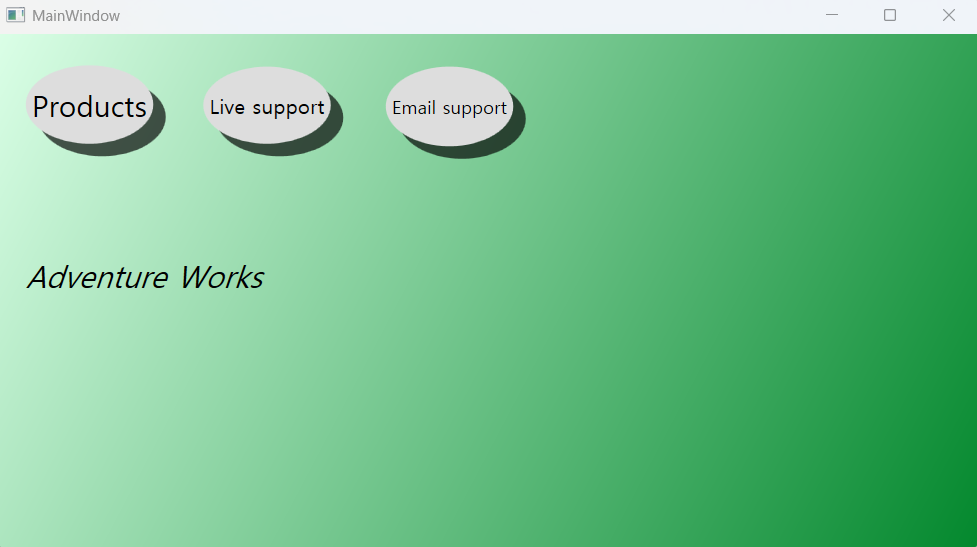
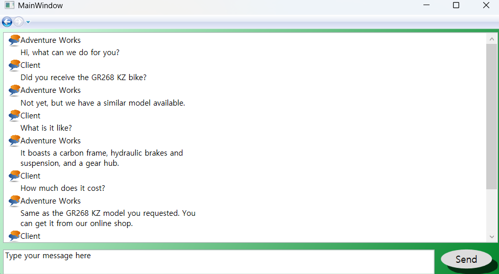
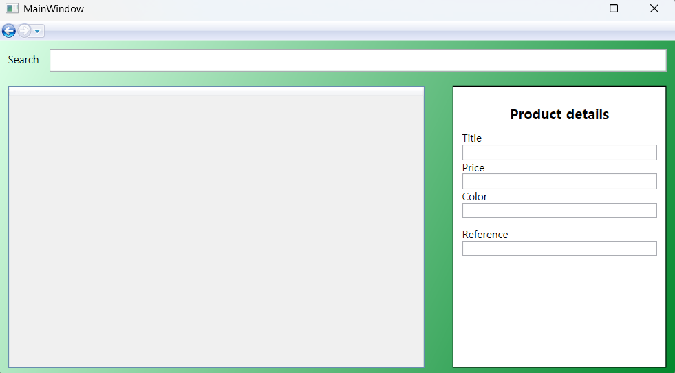

- `Menu.xaml`: 버튼 클릭 이벤트 사용, 암시적 스타일 사용(Discussion.xaml 페이지의 ControlTemplate 요소 적용)  

- `Discussion.xaml`: ListBox, ItemTemplate 속성 사용  

- `contact.xaml`: TextBox 컨트롤 사용   
  

- `ProductsManagement.xaml`: 데이터 바인딩 사용
- `ProductsManagementMVVM.xaml`: MVVM 패턴 활용
- 기본 버튼 템플릿, 리소스 활용(기본 배경: App.xaml의 Application.Resources -> 각 페이지에서 사용)  
