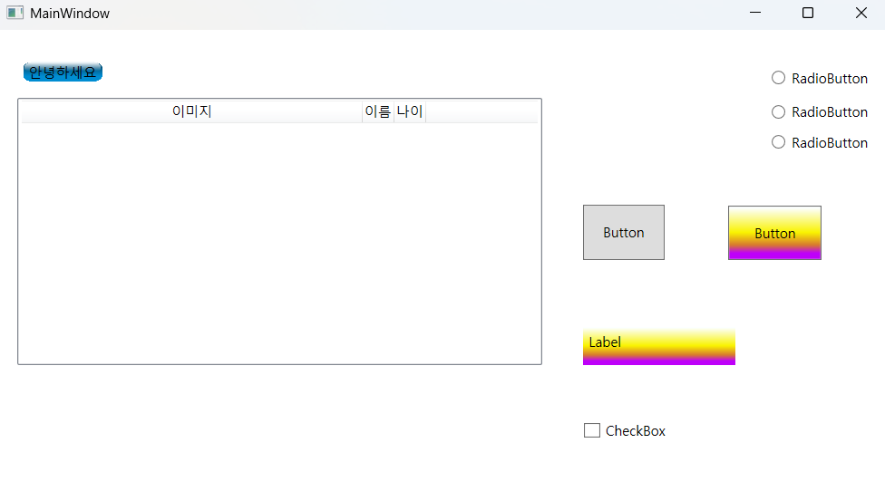
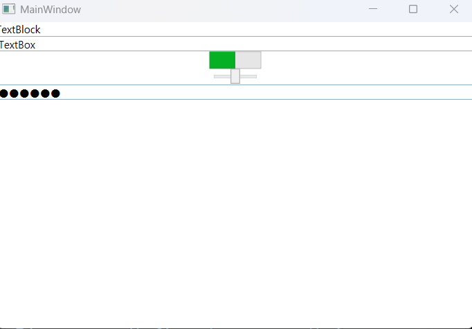
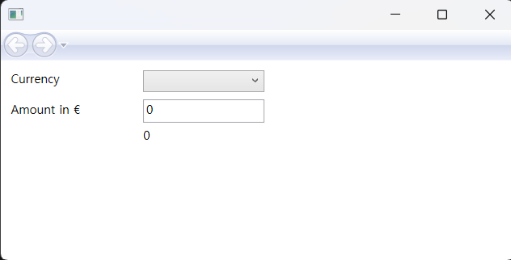
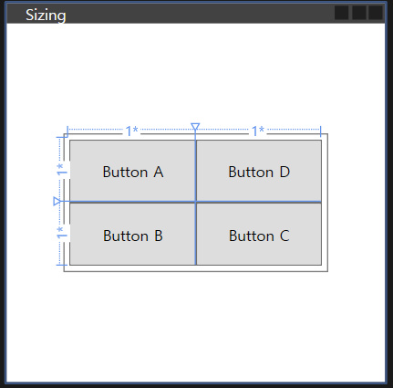
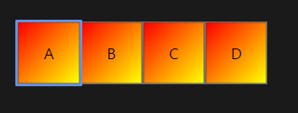
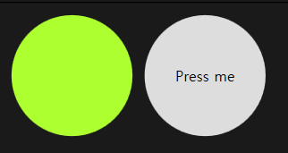

## 목적
WPF 코드 수집 및 활용

### 1. 파일 개요
#### [`01_WPFapplication`](./01_WPFApplication/) : WPF 간단 예제, 연습(SmartFactory)

- 

#### [`02_BikeShop`](./02_BikeShop/): BikeShop 예제 직접 타이핑, 구현

- `contact.xaml`: TextBox 컨트롤 사용 
- `Menu.xaml`: 버튼 클릭 이벤트 사용, 암시적 스타일 사용(Discussion.xaml 페이지의 ControlTemplate 요소 적용)
- `Discussion.xaml`: ListBox, ItemTemplate 속성 사용
- `ProductsManagement.xaml`: 데이터 바인딩 사용
- `ProductsManagementMVVM.xaml`: MVVM 패턴 활용
- 기본 버튼 템플릿, 리소스 활용(기본 배경: App.xaml의 Application.Resources -> 각 페이지에서 사용)

#### [`03_BikeShop_book`](./03_BikeShop_book/): 위의 바이크샵 원본 코드

#### [`04_StartAssets`](./04_StartAssets/): Discussion에서 Talk.cs 파일 사용

#### [`05_WpfBasicControlApp1`](./05_WpfBasicControlApp1/)

- 기본 컨트롤 예제

#### [`06_WpfDemos`](./06_WpfDemos/): 환율 변환 데이터바인딩, MVVM 패턴 적용

- 액션을 처리하는 방법
- 액션처리를 MVVM 적용

- `sizing.xaml`: Grid 컨트롤 적용
  
  

- `Styling.xaml`: 스타일 적용
  
  

- `Templating.xaml`: 템플릿, 템플릿 바인딩 적용